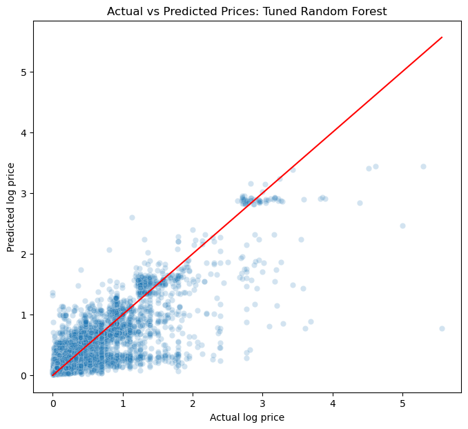

# Ethereum NFT Transaction Value Analysis

An exploratory data science project studying how historical transfer activity
and price-related features relate to Ethereum NFT transaction value. The workflow
combines SQLite, pandas, visual analysis, linear regression and Random Forest.

**Question:** Do historical collection, token, sender and receiver features help
predict the log value of later observed transactions?

**Scope:** This is a portfolio research prototype. Transaction value is a proxy
for NFT price; it is not a verified individual NFT sale price.

## Verified results

Fresh-kernel run on September 24, 2026, using the 100,000-row source sample:

| Model | Test MAE, log1p(ETH) | Test R², log1p(ETH) |
| --- | ---: | ---: |
| Median baseline | 0.195345 | -0.035098 |
| Linear regression | 0.114677 | 0.679897 |
| Original Random Forest | 0.117972 | 0.686848 |
| Tuned Random Forest | 0.107617 | 0.703683 |

The tuned forest had the lowest test log-MAE among these models, approximately
45% below the baseline. Its ETH-scale MAE was **0.2682 ETH**, with median absolute
error **0.0673 ETH**. Historical collection average log value had the largest
permutation importance. The actual-versus-predicted plot shows underprediction
of several high-value observations. These are exploratory results under the
limitations below, not a general NFT valuation accuracy claim.



## Explore the project

- [Analysis notebook](notebooks/nft_analysis.ipynb): data checks, plots, feature engineering and model comparison.
- [Results report](reports/analysis_report.md): regenerated metrics and interpretation.
- [Data setup](data/README.md): expected schema, source status and exclusions.
- [Sample SQL](sql/sample_transfers.sql): deterministic positive-value sample query.

## Reproduce

Validated environment: Python 3.13.9. Run these commands from the repository root:

```bash
python3 -m venv .venv
source .venv/bin/activate
python -m pip install -r requirements.txt
python -m ipykernel install --sys-prefix --name python3 --display-name "Python 3"
export NFT_DB_PATH="/absolute/path/to/nfts.sqlite"
python scripts/run_notebook.py
```

Alternatively place the database at `data/nfts.sqlite` and omit the environment
variable. The runner executes the entire notebook in a fresh kernel and updates
its outputs, aggregate CSVs, figures and report. Tuning performs 36 fits plus
refits and comparison fits, so runtime depends on your computer. It uses two
workers. Models and row-level predictions are written to ignored `artifacts/`.
Only load joblib model files that you trust.

## Method

1. Select 100,000 positive-value transfer rows in database row order.
2. Convert wei to ETH, inspect missingness, duplicates and extreme values.
3. Create calendar, observed activity, previous-token-value and historical-average features.
4. Retain transactions with one observed NFT transfer **within the sample**.
5. Split chronologically into 80% training and 20% testing rows.
6. Compare a median baseline, linear regression and Random Forest on `log1p(value_eth)`.
7. Tune a forest with three-fold time-series CV and 12 sampled configurations.
8. Select between original and tuned forests using **training CV MAE**, then report holdout diagnostics and permutation importance.

## Evaluation limits

- Positive transaction value does not establish a sale. A transaction can fund
  several transfers or include other payments. Sender/receiver are not verified
  sellers/buyers, although the original feature names use those terms.
- The fixed sample spans August 1–5, 2021 and is not representative of all NFTs. Activity and token age
  reflect observed sample history, not lifetime blockchain history.
- Bundle counts are sample-local; transfers outside the sample can be missed.
- Event IDs are tie-breakers, not verified execution order. Same-block records
  may use information unavailable at prediction time and may cross split/fold
  boundaries. A future rigorous benchmark should group transactions/blocks,
  reconstruct strictly prior-block features and use a new holdout period.
- Test features use earlier test outcomes. This is sequential, updating-history
  evaluation, not forecasting an entire future period at once.
- Original and tuned models are compared on an already explored holdout. Moving
  final selection to CV avoids a direct test-MAE selection rule but does not
  turn this existing sample into a pristine, unseen benchmark.
- Log-scale MAE is not ETH error. R² describes variation in log transaction value.
  Feature importance is predictive association, not evidence of causation.

## Repository layout

```text
notebooks/nft_analysis.ipynb   Main analysis, narrative and verified outputs
scripts/run_notebook.py       Fresh-kernel execution and figure export
sql/sample_transfers.sql      Sample extraction query
data/README.md               Data setup and provenance status
reports/                     Aggregate metrics, report and figures
artifacts/                   Ignored local model and row-level predictions
requirements.txt             Pinned analysis dependencies
```

## Data and attribution status

The source is [Ethereum NFTs by Sophia Arakelyan et al. / Moonstream](https://www.kaggle.com/datasets/simiotic/ethereum-nfts),
version 1, licensed CC BY 4.0. See [data setup and attribution](data/README.md). No database, downloaded reference notebook or
original HTML export is bundled. No open-source license has been chosen for the
project code yet.
